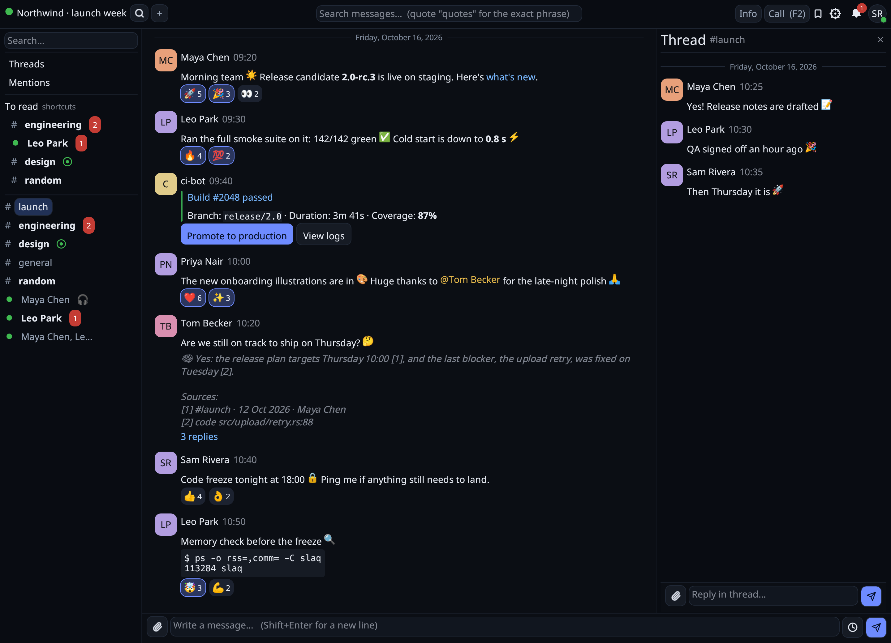

# slaq

An alternative Slack client in Rust, for one specific reason: the official
client is a web page inside Electron, and on my machine it sits at **around
1 GB of RAM** all day.

```
official client   ~1000 MiB
slaq                113 MiB
```

Same workspace, same channels open, calls included. (Measured before the mod
system existed; mods you enable add their own memory.)



## What it does

Everything below works and is used daily.

**Messages.** Channels, direct messages and group conversations, with the
sidebar folders you set up in Slack. Threads, reactions, editing and deleting
your own messages, file upload by drag-and-drop or button, attachment download,
message search, permalinks, forwarding, slash commands (`/remind`, `/me`, …),
and saving for later or pinning a message to its channel — both synced with
Slack, the saved ones listed in their own view, the pinned ones in the channel
info panel. `@` and `#` autocompletion. Paste a
screenshot straight from the clipboard with `Ctrl+V`. Full mrkdwn rendering
with avatars, colour emoji and workspace custom emoji.

**Presence.** Who is online, away, or in quiet hours, plus their chosen status
emoji — all live over the WebSocket.

**Calls.** Native huddles with echo cancellation and noise suppression. `F2`
joins the call for the open conversation; a bar shows duration, mute and hang
up. Incoming calls ring: a bar offers Answer or Ignore, a marker in the
sidebar shows which conversations have a huddle running. Screen sharing is
native: you send with VP8 and receive with AV1.

**Notifications.** Desktop notifications for direct messages, mentions and
broadcasts, matching Slack's own defaults.

**Mods.** Extensions you install yourself: sandboxed WebAssembly components,
each on its own thread, that can do only what you allow.
- **Permissions:** you grant them one by one in the Mods dialog, choose which
  channels a mod reads and which hosts it reaches, and can stop any mod from the
  **Running mods** window.
- **What a mod can do:**
  - read messages and channel history;
  - add notes under messages, message actions, views, dialogs, slash commands
    and themes;
  - keep a private store;
  - call allowed hosts;
  - search folders you map;
  - run in the background.
- **Published mods:** *Second Brain* (cited answers from your Slack, code and
  notes through an LLM) and a *Light theme*.
- **Writing one:** [`docs/mods/`](docs/mods/), starting with
  [`HOW_TO_WRITE_MODS.md`](docs/mods/HOW_TO_WRITE_MODS.md).

Two front ends share one core: a terminal UI and a native GUI (egui). The GUI
is where the work has gone; the TUI has channels, messages, threads and
sending, and lags behind on everything else. Build without it with
`--no-default-features` if you only want the terminal.

## Running it

```
cargo build --release --features mods   # GUI + TUI + VP8 + mods (what the download ships)
cargo build --release                   # the same without mods
cargo build --release --no-default-features   # TUI only, no graphics stack

./target/release/slaq login        # store the session token
./target/release/slaq gui          # or `tui`
```

What to install first (distro packages, a browser for the login, etc.):
[docs/install.md](docs/install.md).

`slaq --help` lists the rest:
- **Messages:** `send`, `slash`, `upload`, `download`, `pins`, `saved`,
  `threads`.
- **Conversations:** `new-channel`, `group-dm`, `channel-rename`,
  `channel-invite`, `channel-kick`, `channel-leave`, `channel-archive`.
- **Local data:** `channels`, `history`, `cache`.
- **Calls:** `call`, `huddle`.
- **Mods:** `mods` (list, grant/revoke, channels and hosts, folders, secrets)
  and `mod` (run one headless).
- **Debug:** `listen`, `notify-test`.

### Calls from the terminal

```
./target/release/slaq call -c C0123456789 --audio --unmuted -i
```

Joins and stays until you hang up. Space toggles mute, `q` leaves. This opens
a **real huddle** that everyone in the channel can see.

## How it authenticates

With the session token (`xoxc-…`) and cookie (`d=…`) that your browser already
holds — the same credentials the official client uses. There is no OAuth app
and no bot: this is your own account, talking to the same internal API the
desktop client talks to.

That has consequences worth understanding before you use it:

- **it is not a documented API.** Slack can change it without notice, and has;
- the session token belongs to your account. Anyone who gets it has your
  access. `slaq` keeps it in the system keyring (Secret Service on Linux) when
  one is available, and otherwise in `~/.config/slaq/credentials.json` with
  `0600` permissions;
- your workspace administrators can see which client connects. If your
  organisation has a policy about third-party clients, this is covered by it.

The user agent says `slaq/<version>` and does not pretend to be the official
client. That is deliberate: impersonating it would make the traffic harder to
attribute, which is exactly the wrong thing to do with someone else's
workspace.

## Where things are kept

| What | Where |
|---|---|
| Credentials | system keyring, or `~/.config/slaq/credentials.json` |
| Message and channel cache | `~/.local/share/slaq/cache.db` (SQLite) |
| Avatars, emoji, previews | `~/.cache/slaq/images/` |
| Installed mods | `~/.config/slaq/mods/<mod>/` (or `$SLAQ_MODS_DIR`) |
| What you granted each mod; their settings | `~/.config/slaq/mods-grants.json`, `mods-settings.json` (secrets: system keyring) |
| Each mod's private data | `~/.local/share/slaq/mods/<mod id>/` |

The cache is what makes reopening instant: channels and history come from disk
first, and the network only fills in what changed. `slaq cache clear` throws
it away; nothing is lost that cannot be fetched again.

## What is missing

- **video** — huddles are audio only (screen sharing *is* there, natively:
  sent in VP8, received in AV1);
- **link/media previews** — a link's unfurl image is not drawn;
- **multi-workspace** — one workspace at a time;
- **the TUI**, which is far behind the GUI: channels, messages, threads,
  sending and the mods' consent dialog, and little else.

## Notes on the internals

`docs/huddle-protocol.md` documents the Chime signalling protocol behind
huddles, including the wrong turns: the section that blocked progress for weeks
was based on a diagnosis that turned out to be false, and it is left in place,
marked as such, because the reasoning is more useful than the conclusion.

`docs/roadmap.md` tracks what is done and what is not. The mod system's design,
contract and plan are in `docs/mods/` (start from its README); the security
posture is in `docs/security.md` and `docs/threat-model.md`.

## Checks

Every push to `main` and every pull request runs the security workflow
(`.github/workflows/security.yml`):
- build and tests;
- clippy;
- `cargo-deny` and `cargo-audit`;
- gitleaks, semgrep and trivy.

The same gate runs locally:

```sh
scripts/security-check.sh
```

Install the versioned pre-push hook so it runs before anything leaves your
machine:

```sh
scripts/install-hooks.sh    # git config core.hooksPath scripts/githooks
```

A single push can bypass it with `git push --no-verify` (CI still runs).

## Licence

MIT — see `LICENSE`. The bundled emoji font is Google's Noto Emoji, under the
SIL Open Font License 1.1 (`src/gui/data/NotoEmoji-LICENSE.txt`).
